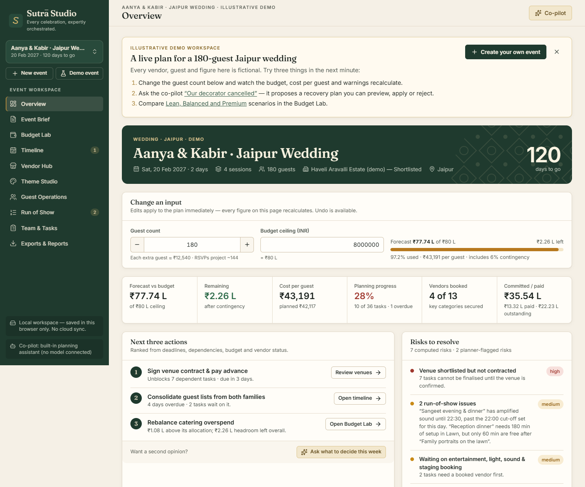
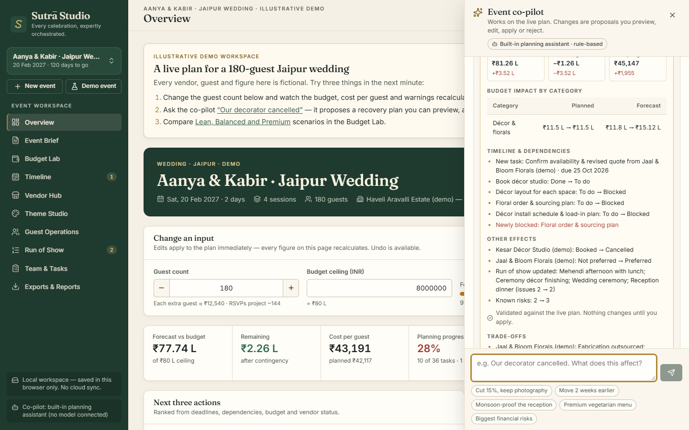

# Sutrā Studio

[](https://github.com/NextGenDev-KSK/sutra-studio/actions/workflows/ci.yml)
[](https://github.com/NextGenDev-KSK/sutra-studio/actions/workflows/deploy.yml)


[](LICENSE)

**Every celebration, expertly orchestrated.** A GenAI-powered planning studio for professional event planners: it turns a brief into a coordinated, change-aware plan — budget, timeline, vendors, themes, guests and the event-day run of show — with a co-pilot that proposes concrete, validated changes instead of just chatting.

**Live demo:** https://nextgendev-ksk.github.io/sutra-studio/ — opens on a fully populated, clearly labelled illustrative demo (a 180-guest Jaipur wedding, 120 days out). No sign-up, no key.



## Problem statement alignment

> *Challenge 5 — Celebration & Event Planner: create a GenAI-powered planning assistant that helps users organize weddings, birthdays, community events, and other celebrations with budgets, timelines, vendor checklists, and personalized ideas.*

| Challenge asks for | Sutrā Studio delivers |
|---|---|
| GenAI-powered planning assistant | **Co-pilot** that turns plain-language requests ("Our decorator cancelled", "Cut 15% without touching photography", "Move the event two weeks earlier") into **validated plan changes** with a preview of budget, timeline and dependency impact — apply, edit, reject or undo. Uses **Claude** (`claude-opus-5`, structured output) via a server endpoint, with a deterministic built-in assistant when no key is configured. |
| Weddings, birthdays, community events, other celebrations | 10 event types (wedding, engagement, birthday, anniversary, baby shower, community gathering, festival, cultural, corporate, custom), each with its own budget categories, sessions, lead times and task templates |
| Budgets | **Budget Lab**: planned → quoted → committed → paid → forecast per category, contingency reserve, variance warnings, cost per guest, payment schedules, Lean / Balanced / Premium scenarios fitted to the client's ceiling |
| Timelines | Dependency-aware **Timeline** with critical path, overdue and venue/vendor blockers; event-date changes reschedule safely and report what changed; calendar and .ics export |
| Vendor checklists | **Vendor Hub** pipeline (identified → booked), quote comparison at the current headcount, booking/cancellation consequences, verification with source + date |
| Personalized ideas | **Theme Studio** concepts personalised by event type, guests, city & season, setting, budget, lead time and accessibility; guest-experience ideas in the brief |

## Quick start

Requirements: Node.js 20.19+ or 22.12+ (tested with Node 22 and 24).

```bash
npm install
npm run dev          # http://localhost:5173
```

**Optional — model-backed co-pilot.** Create `.env.local` (never commit it):

```bash
ANTHROPIC_API_KEY=sk-ant-...      # server-side only — never prefix with VITE_
SUTRA_MODEL=claude-opus-5         # optional override
```

`npm run dev` or `npm run preview` then serve `/api/copilot`, which calls Claude. Without a key — and on static hosting such as GitHub Pages — the co-pilot uses its built-in, rule-based planning assistant and says so in the UI.

## Scripts

| Command | What it does |
|---|---|
| `npm run dev` | Development server with the co-pilot API |
| `npm run build` | Typecheck + production build into `dist/` |
| `npm run preview` | Serve the production build with the co-pilot API (port 4173) |
| `npm run verify` | Format check, typecheck, lint, tests with coverage thresholds, build |
| `npm test` / `npm run test:coverage` | 52 Vitest tests: unit, component (React Testing Library) and integration |
| `npm run test:e2e` | 21 Playwright tests: acceptance A–J, responsive K (360–1440 px), axe accessibility |
| `npm run test:e2e:preview` | Same browser suite against the production build (with its CSP) |
| `npm run format` / `npm run lint` / `npm run typecheck` | Prettier, ESLint (typescript-eslint + react-hooks), strict TypeScript |

Locally the browser tests use the installed Microsoft Edge; CI installs Playwright's Chromium.

## How it meets the evaluation criteria

### Code quality
- **Layered, typed architecture**: pure domain engines (`src/domain`) with no React; a single Zustand store funnels every write; views only render derived data. See [Architecture](docs/ARCHITECTURE.md).
- **One change pipeline** for people and AI: 18 zod-typed plan operations → validate → preview (impact diff) → apply / edit / reject / undo.
- Strict TypeScript, ESLint and Prettier enforced in CI; error boundary per view; no dead exports.

### Security
- API key read only by server middleware — never bundled; `.env*` git-ignored.
- **Content-Security-Policy** (`default-src 'self'`, `script-src 'self'`, `object-src 'none'`…) and referrer policy on the production build; no `innerHTML`/`eval`; fonts bundled locally.
- zod validation for imports **and AI output**; CSV formula-injection neutralised; co-pilot endpoint has method checks, a 400 kB body limit, rate limiting, timeouts and generic error messages.
- Guest names/contacts never sent to the model (tested). `npm audit` in CI; Dependabot. Details: [SECURITY.md](SECURITY.md).

### Efficiency
- Views are **code-split** and lazy-loaded: the main bundle went from 767 kB to 481 kB (≈153 kB gzipped) and each view loads on demand as a 3–8 kB gzipped chunk.
- Derived insights are **cached per immutable plan version** (WeakMap), so every view and table row shares one computation instead of recomputing.
- Text inputs commit on blur, so typing doesn't spam the store or the activity log; no runtime network calls except the optional co-pilot.

### Testing
- **52 Vitest tests** — budget reconciliation with exact figures, scenarios, rescheduling, run-of-show conflicts, every co-pilot intent, model-output conversion, fallbacks with mocked network, import/CSV attacks, server request validation, and React component behaviour.
- **Coverage gates** in CI on the logic layers (currently ≈93% lines, ≈93% functions).
- **21 Playwright tests** in a real browser: the brief's acceptance tests A–J, responsive K and accessibility, run against the production build in CI. See [Test report](docs/TEST_REPORT.md).

### Accessibility
- **axe-core scan: 0 serious or critical WCAG 2.1 A/AA issues** across all views, the intake, reports, the co-pilot and drawers — enforced in CI.
- Focus-trapped dialogs with Escape and focus return, skip link, labelled fields with inline validation, live regions for toasts and the co-pilot, visible focus rings, reduced-motion support, keyboard-reachable scroll regions.
- Charts never rely on colour or tooltips alone: values are printed beside every bar and tables carry the same data.

### Problem statement alignment
See the table above and the [rubric alignment](docs/RUBRIC_ALIGNMENT.md).



## Honesty by design

- **Illustrative data is labelled everywhere.** Demo vendors are fictional, carry an "Illustrative · not verified" badge and have no phone numbers, emails, ratings or websites. Budget benchmarks are labelled as estimates, not market prices.
- **Verification needs evidence** — a source URL and the date checked.
- **No assumed culture.** Ceremonies, religion and diet are never inferred from names or places.
- **Local workspace, stated plainly.** Plans persist in this browser only; there is no cloud sync, and the sidebar says so.
- **Co-pilot mode is always visible** ("Built-in planning assistant · rule-based" or "Claude · model"); fallbacks are announced.

## Deployment

- **GitHub Pages** (this repo's live demo): `.github/workflows/deploy.yml` builds and publishes `dist/` on every push to `main`. Static hosting → built-in co-pilot.
- **With live Claude**: run the production build on any Node host with `npm ci && npm run build && npx vite preview --host 0.0.0.0 --port $PORT` and set `ANTHROPIC_API_KEY` in the host's environment.

## Known limitations

- Local-only storage (export/import JSON to move plans); no accounts or real-time collaboration.
- A successful live Claude response has not been observed yet (no key during development); the request path, error mapping and response validation are tested with mocks and an invalid key.
- Budget benchmarks are illustrative heuristics; seasonal guidance is general climatology for Indian cities.
- PDF output uses the browser's print dialog; tested in Chromium-based browsers only.

## Project structure

```
src/
  domain/      Pure, typed engines: budget, scenarios, timeline, run of show, guests, themes,
               brief + intake generation, operations (validate/apply), impact diff, insights,
               import/export, demo seed
  copilot/     Rule-based engine, model response schema, provider with fallback
  store/       Zustand workspace store: persistence, activity log, undo
  views/       Lazy-loaded workspace views, co-pilot panel, proposal preview, reports
  ui/          Accessible primitives, charts, error boundary
  styles/      Design system (tokens, components, responsive, print)
server/        Co-pilot API middleware (Anthropic SDK, structured output)
tests/         Vitest unit, component and integration tests
e2e/           Playwright acceptance, responsive and accessibility tests
docs/          Architecture, demo script, rubric alignment, build narrative, test report
```

## Documentation

[Architecture](docs/ARCHITECTURE.md) · [Demo script](docs/DEMO_SCRIPT.md) · [Rubric alignment](docs/RUBRIC_ALIGNMENT.md) · [Build narrative](docs/BUILD_NARRATIVE.md) · [Test report](docs/TEST_REPORT.md) · [Security](SECURITY.md)

## License

[MIT](LICENSE)
